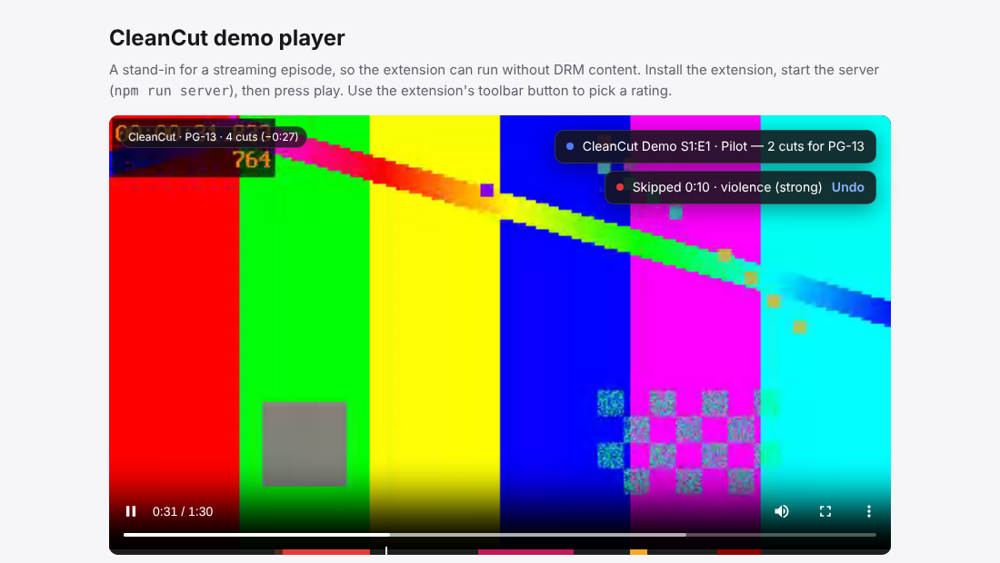
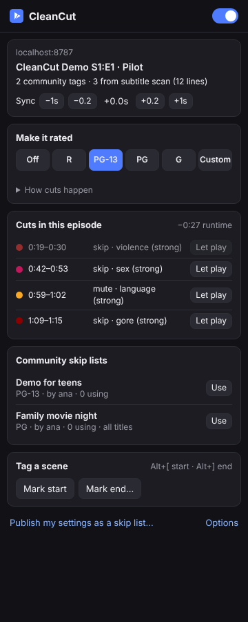
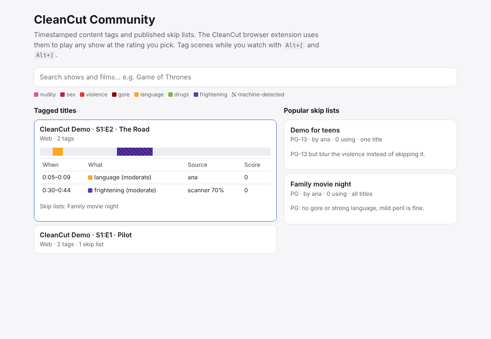

# CleanCut

**Watch any show at the rating you choose.** CleanCut is a browser extension
that runs on top of Netflix and Prime Video (and any page with a `<video>`).
It recognizes what's playing, looks up timestamped content tags, and **skips,
mutes or blurs** the scenes above your chosen rating. Take *Game of Thrones*
and watch an R, PG-13, PG or G cut of it.

It has three parts:

| Part | What it does | Where |
| --- | --- | --- |
| **Browser extension** (Chrome / Edge / Firefox, Manifest V3) | Identifies the title, applies your rating, scans the episode's subtitles ahead of playback, lets you tag scenes and submit them | [`extension/`](extension) |
| **Community data** (JSON files in this repo, published on GitHub Pages) | Reviewed scene tags and shared skip lists. Contributions are pull requests; there is no server to run | [`community/`](community), [`site/`](site) |
| **Scanner CLI** (`cleancut-scan`) | Runs lightweight vision models over video files offline and publishes machine-detected segments | [`scanner/`](scanner) |

<p>
  
  
</p>

They share one core ([`shared/`](shared)): the content taxonomy, the rating
presets, the decision engine, subtitle parsing and the subtitle analyzer.

---

## How it works

```
                 ┌───────────────────────── browser tab (netflix.com / primevideo.com / …) ──────────────────────────┐
                 │                                                                                                    │
 player's own    │  page-hook.js (page world)            content script                                              │
 network calls ──┼─▶ sees manifest / metadata JSON ──────▶ identify title ──▶ lookup ─────────────┐                  │
                 │   fetches full English SDH subtitles ─▶ analyzer: profanity + [sound cues] ─────┤                  │
                 │   Netflix seek bridge ◀──────────────── engine: decide(t) every 100 ms ◀── plan ◀┘                  │
                 │                                          │ skip → seek past   mute → video.muted   blur → CSS filter │
                 └──────────────────────────────────────────┼─────────────────────────────────────────────────────────┘
                                                            ▼
                                   background worker ──▶ GitHub Pages: data/v1/index.json (+ one title file if listed)
                                                            ▲
                                   cleancut-scan (offline): ffmpeg frames → ONNX classifier → segments ─┘
```

1. **Identify.** Each platform adapter works out what is playing. Netflix uses
   the `/watch/<id>` URL plus the player's metadata response, Prime uses the
   episode ASIN from its playback-resources response, and other sites use
   `<meta name="cleancut:*">` tags or the URL. Each title also gets a
   *canonical key* (`game-of-thrones/s01e01`), so tags made on one platform
   can be offered on another.
2. **Gather segments** from three sources:
   - **Community tags:** humans marked a scene with a category and severity; each was reviewed in a pull request.
   - **Your own tags:** marked with `Alt+[` / `Alt+]` while watching.
   - **Scan-ahead:** the subtitle track is analyzed the moment the player
     downloads it, before the scenes play (see below).
3. **Plan.** Your profile sets the highest severity allowed per category. Every
   segment above it becomes an action (skip, mute or blur). Nearby regions are
   merged so playback doesn't stutter.
4. **Act.** A 100 ms loop compares playback time against the plan and skips,
   mutes or blurs. A toast shows what happened, with **Undo**, which lets that
   scene play.

### Ratings

Severity runs from 1 (mild) to 3 (strong). Each preset is the highest severity
allowed to play; anything above it is cut.

| Preset | Nudity | Sex | Violence | Gore | Language | Drugs | Frightening |
| --- | --- | --- | --- | --- | --- | --- | --- |
| R | moderate | moderate | any | moderate | any | any | any |
| PG-13 | none | mild | moderate | mild | moderate | moderate | any |
| PG | none | none | mild | none | mild | mild | moderate |
| G | none | none | none | none | none | none | mild |
| Custom | per-category sliders | | | | | | |

By default, language is **muted** (captions hide too) and everything else is
**skipped**. Any category can be set to skip, mute or blur instead.

### Scan-ahead with lightweight models

Streaming video is DRM-encrypted, so a browser extension **cannot see the
frames**. Drawing a protected video to a canvas gives black. CleanCut therefore
scans in two places:

- **In the browser: the subtitle track.** Netflix and Prime download the full
  subtitle file at playback start. The page hook reads the track list from the
  player's own JSON, fetches the English SDH track, and the analyzer
  ([`shared/analyzer.js`](shared/analyzer.js)) processes the whole episode in
  milliseconds:
  - *Profanity* in dialogue becomes precise mute segments, by line or by
    estimated word timing.
  - *Sound descriptions* in SDH captions (`[moaning]`, `[gunfire]`,
    `[bones crunching]`) and suggestive dialogue become scene hints. Hints of
    the same category are clustered over time, and their confidences compound
    (1 − Π(1 − cᵢ)). Three sex-related cues in ten seconds come out as one
    sex scene at about 83% confidence.

  Machine segments are **suggestions** unless they clear your confidence bar
  (default 60%). The timeline shows them hatched.
- **Offline: the frames.** `cleancut-scan` runs any Hugging Face-style ONNX
  image classifier over a video file you have lawful access to, smooths the
  per-frame scores into scenes, and publishes them to the database as
  `scanner` segments for people to confirm.

---

## Quick start

Requires Node 22.13+ (for the built-in `node:sqlite`) and, for the demo video
and scanner, `ffmpeg`.

```bash
cd cleancut
npm install
npm run build          # → extension/dist/chrome and extension/dist/firefox
npm run demo:video     # generates server/public/demo.webm (ffmpeg)
npm run server         # demo page only: http://localhost:8787/demo
```

(`npm run server` is only the local demo page host. Community data comes from static files, see [Community data](#community-data).)

**Load the extension**

- Chrome / Edge: open `chrome://extensions`, turn on *Developer mode*, choose
  *Load unpacked*, and pick `extension/dist/chrome`.
- Firefox 128+: open `about:debugging#/runtime/this-firefox`, choose *Load
  Temporary Add-on*, and pick `extension/dist/firefox/manifest.json`. Then
  grant the site permissions from the extension's menu.

**Try it on the demo:** open http://localhost:8787/demo and press play. The
demo's own subtitles are scanned: at 0:44 a sex scene is skipped because
scan-ahead found it in the SDH captions, and at 1:00 the strong language is
muted. (`npm run test:e2e` additionally serves a tagged dataset and checks the
tagged skips at 0:20 and 1:10.) Switch ratings from the
toolbar popup and the cut changes. `/demo?mode=hook` serves captions the way
Prime does, through a playback JSON, to exercise the subtitle-fetching path.

**On Netflix / Prime Video:** pick a rating in the popup and play an episode.
If the popup says *subtitles not scanned yet*, turn on **English [CC]** once
so the player downloads the track. You can hide captions again afterwards;
the scan stays.



### Tagging and sharing

- Press `Alt+[` when a scene starts and `Alt+]` when it ends, then pick a
  category and severity. The tag applies immediately, on your device.
- To share it: **Options → Your tags → Submit on GitHub…**. CleanCut builds the
  file and opens GitHub's "new file" page with it filled in; **Propose new file**
  creates the pull request (GitHub forks the repo for you if you can't write to it).
  CI validates it, a maintainer reviews it, and on merge it's published.
- **Share my settings as a skip list…** in the popup does the same for your rating
  settings, for this title or for everything. Scenes you chose to *Let play* become
  explicit exceptions. Others see the list in their popup and can **Use** it.
- There are no accounts or votes: the pull request review is the moderation.

### Community data

```
community/titles/<platform>/*.json   tags for one title (several files per title are merged)
community/lists/*.json               shared skip lists
```

`npm run data:check` validates the files (CI runs it on every pull request);
`npm run site` builds the website plus `data/v1/` for GitHub Pages. File formats and the
review checklist are in [`community/README.md`](community/README.md); hosting and upkeep in
[`docs/OPERATIONS.md`](docs/OPERATIONS.md).

### Scanner

```bash
# subtitle analysis only (SRT, WebVTT, TTML/DFXP)
node scanner/src/cli.js subtitles episode.srt

# frames with a real model (optional dependency onnxruntime-node, installed by npm install)
#   model dir: config.json + preprocessor_config.json + onnx/model_quantized.onnx
#   e.g. https://huggingface.co/onnx-community/nsfw_image_detection-ONNX
node scanner/src/cli.js video episode.mkv --model ./models/nsfw --map nsfw=nudity --subs episode.srt -o scan.json

# frames with the no-model heuristic baseline (scores capped at 50%, so they stay suggestions)
node scanner/src/cli.js video episode.mkv -o scan.json

# publish against the platform's own video id (times must match that encode)
node scanner/src/cli.js publish scan.json --platform netflix --id 70248288 \
  --series "Game of Thrones" --season 1 --episode 1 --key "$CLEANCUT_API_KEY"
```

The quantized NSFW ViT runs at about 8–9 frames per second on a laptop-class
CPU, so a one-hour episode sampled at 1 fps takes about 7 minutes. `--map`
lets any classifier feed any category: a violence or gore model, for example,
with `--map violent=violence`.

---

## Data endpoints

The extension reads two kinds of static file from `DATA_BASE` (`extension/src/config.js`):

| Path | Contents |
| --- | --- |
| `index.json` | `{ titles: { "<platform>:<id>": { f, canonicalKey, segmentCount, title } }, canonical: { key: [titleKey…] }, lists: [skip lists] }` |
| `titles/<platform>/<hash>.json` | `{ title, segments: [{ id, start, end, category, severity, action?, note? }] }` |

Segment categories: `nudity, sex, violence, gore, language, drugs, frightening`.

The `server/` folder (accounts, votes, a JSON API) is **not used by the extension**. It's kept as a
possible later upgrade; see `docs/OPERATIONS.md`.

---

## Tests

```bash
npm test            # unit, dataset, API and scanner tests (node:test)
npm run test:e2e    # loads the built extension in headless Chromium against the demo and a static dataset
```

The end-to-end test plays the demo episode and checks:

- the community-tagged skip (from the static dataset), the scan-ahead skip, mute and unmute, and gore;
- the blur action;
- R, PG-13 and unfiltered producing different cuts;
- Undo and adopting a published list;
- that only the index and the needed title file are downloaded, and that "Submit on GitHub" builds a valid pull-request link;
- keyboard tagging;
- the page-hook subtitle path;
- that the popup and options pages render without errors.

---

## Limits and honest caveats

- **Not tested against live Netflix or Prime Video.** That needs real
  accounts. The adapters follow the players' current DOM and JSON shapes,
  which change without notice. Every extractor is defensive, and the code
  marks each place that depends on site internals. Expect to maintain
  selectors.
- **Netflix seeking** goes through the player's own API, because setting
  `video.currentTime` crashes the Netflix player (error M7375). If Netflix
  changes that API, skips fail and mutes and blurs keep working.
- **Prime Video** can offset media time from programme time (and ad breaks
  shift it further). The adapter recalibrates against the on-screen clock
  whenever it is visible, and the popup has a manual **Sync** nudge.
- **Cross-platform timing.** Tags are timed against one platform's encode.
  When a title only has tags from another platform, they are offered with a
  warning and the sync control. Automatic alignment, by matching subtitle cue
  timings between platforms, is the next step (see Roadmap).
- **Subtitle hints are hints.** `[moaning]` can be pain, and plenty of scenes
  have no caption at all. That is why machine segments carry a confidence and
  default to suggestions. People confirming tags is what makes a cut reliable.
- **Seeing a skipped scene's first frames.** The engine acts about 150 ms
  early and pads each region, but the first fraction of a second of a scene
  can show. Use *blur* for categories where that matters.
- **Legal.** In the US, the Family Movie Act of 2005 permits skipping and
  muting parts of a film during private home viewing, as long as no altered
  copy is made. CleanCut works that way: it never copies, modifies or
  redistributes the stream. Streaming services' terms of use still apply, and
  rules differ by country. This is not legal advice.
- **Privacy.** Nothing is sent to CleanCut. The extension downloads a public index and,
  only if a title is listed, that title's file from GitHub Pages (GitHub, as host, sees that
  request). Subtitles are analyzed locally and never uploaded. Anything you submit is a public pull request.
- **Slower than a live database.** A new tag is visible to everyone after review, merge, deploy and the
  6-hour index cache. And the dataset starts empty, so early on the subtitle scan does most of the work.

## Roadmap

- Automatic cross-platform sync: store cue-timing fingerprints per title and
  cross-correlate them.
- If review becomes the bottleneck: a hosted server with accounts, votes and instant publishing (`server/` is a start).
- In-browser frame models (onnxruntime-web) for non-DRM sites.
- Adapters for Disney+, Max and Hulu.
- Shareable skip-list links, and following people whose lists you like.
- Non-English lexicons.

## Layout

```
shared/      ratings, engine, subtitles, analyzer, lexicon, sources, identity, validate, dataset, lookup, contribute
extension/   build.mjs, src/{background,page-hook,config}.js, src/content/*, src/popup/*, src/options/*
scripts/     build-data.mjs (validate + publish the dataset)
community/   tags and skip lists (JSON), reviewed via pull requests
site/        landing, privacy and support pages (GitHub Pages)
server/      optional JSON API + demo page host (not used by the extension)
scanner/     src/{cli,frames,classifiers,timeline}.js
test/        *.test.js, e2e/extension.e2e.mjs, fixtures/
```
