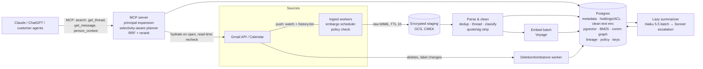
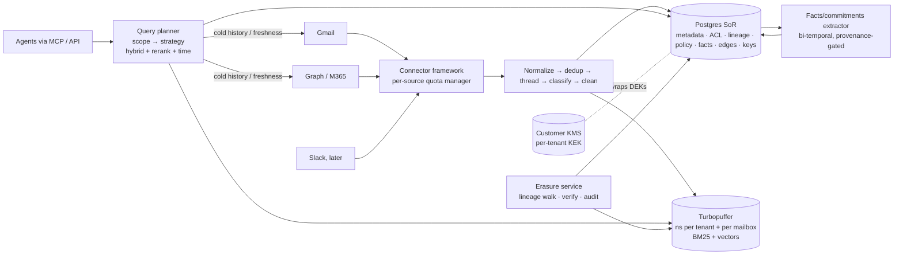

# 05 — What to store, how to structure it, and how agents retrieve it

*Lane: storage, data model and retrieval for the AI context platform. Prepared 2026-11-08. Other workstreams cover ingestion APIs, governance UX, legal and security; this report touches them only where they constrain storage and retrieval. Every cost figure is an **estimate** and shows its assumptions. Prices marked "verified" were checked on the vendor's page on the date above.*

---

## 0. The answer to the founder, in one paragraph

You can't avoid storing *something*, and "pure RAG" is the wrong baseline. Recommendation: a **lean, encrypted, derived index plus live hydration from the source**. Store canonical metadata, the set of mailboxes holding each message (this is the ACL), cleaned "new content" text (quoted replies, signatures and disclaimers stripped), a lexical index, and embeddings. Do **not** keep raw MIME, HTML or attachment binaries; fetch them from Gmail/Graph when an agent opens a message. That's about **4–6% of the raw bytes** (≈100–135 GB vs 2.25 TB for 1,000 users), but it is not "zero duplication": the index and embeddings carry most of the *meaning*, so govern them like a copy. Agents get **tools** (filtered search, open a whole thread, expand a person, follow a timeline) and iterate instead of receiving one top-k dump. Summaries and extraction are **lazy and tiered**. No LLM-built knowledge graph in v1; build a deterministic communication graph from metadata, and add commitments, decisions and temporal facts in v2, in Postgres with provenance.

---

## 1. The storage spectrum

### 1.1 Scorecard

| | (a) Zero-copy / federated | (b) Index-only + pointers | (c) Full encrypted copy | (d) Derived layers only |
|---|---|---|---|---|
| **Retrieval quality** | Poor. Keyword-only, no semantic search, no cross-mailbox dedup, no rerank without extra fetches | Good to very good. Hybrid + rerank if you keep clean text | Best. Can re-chunk and re-embed at will | Fair. Lossy, and can't quote or verify |
| **Latency** | Slow. 1 list + k gets per mailbox; org-wide fan-out isn't interactive | Fast search; hydration adds source round-trips only on "open" | Fastest | Fast |
| **Storage/compute cost** | ~0 storage; quota cost moves to query time | Small (≈4–6% of raw bytes) | Largest bytes, though storage $ is still minor (see §6) | Smallest bytes, but needs LLM passes over everything |
| **Deletion / erasure** | Trivial. Nothing at rest | Needs lineage + purge, but small surface | Hardest. Biggest surface, plus backups | Hard. Derived text mixes sources |
| **Security blast radius (data at rest)** | Minimal | Medium. Index and embeddings leak content (§1.3) | Maximal | Medium. Summaries are concentrated meaning |
| **Dependency on source APIs** | Total. Every query burns quota | Moderate. Backfill + hydration | Low after backfill | Low after processing |

One point holds across all four columns: **the credential is the real blast radius.** A Google domain-wide-delegation service account or an M365 app-only `Mail.Read` grant can read every mailbox. The storage choice changes data-at-rest exposure, not credential exposure. Google's restricted-scope policy also triggers a security assessment if you "store **or transmit** restricted scope data on servers" ([Google](https://developers.google.com/identity/protocols/oauth2/production-readiness/restricted-scope-verification)). A federated proxy *transmits*, so option (a) does not escape the assessment.

### 1.2 (a) Zero-copy: concrete API limits

**Gmail** ([quota page](https://developers.google.com/workspace/gmail/api/reference/quota), verified):
- `messages.list` costs 5 units and returns **only `id` and `threadId`**, at most 500 per page ([ref](https://developers.google.com/workspace/gmail/api/reference/rest/v1/users.messages/list)). No snippets and no relevance scores. The ordering is unspecified.
- `messages.get` costs 20 units, or **60** for `full`/`raw`. `threads.get` costs 40, or 120 for full.
- Limits: **6,000 units/min per user** for projects created on or after 1 May 2026, 1.2M units/min per project, and an **80M units/day per-project threshold**; Google says exceeding quotas "is planned to incur charges… later in 2026" with ≥90 days' notice, and pricing isn't published yet.
- Search is the Gmail search-box syntax (`from:`, `after:`, `label:`, `has:attachment`, `rfc822msgid:`) ([operators](https://support.google.com/mail/answer/7190)). It is lexical only.

Worked example (estimate): a user-scoped search (1 list, 20 metadata gets, 5 full gets) costs ≈**705 units**, so ≈8 searches/min/user; an agent that searches 5 times per task hits the ceiling fast. An org-wide question fanned out to 1,000 mailboxes costs ≈7,600 units, i.e. ≈**10,500 such questions/day for *all* customers combined** before planned charges, because quota is per GCP project.

**Microsoft Graph** (verified):
- `$search` on `/messages` uses KQL and "returns up to 1,000 results… **sorted by the date and time the message was sent**", not by relevance ([docs](https://learn.microsoft.com/en-us/graph/search-query-parameter)).
- The Microsoft Search API (`/search/query`) runs only "in the context of the signed-in user" with delegated permissions. Pages for `message` are capped at 25, results are date-sorted, and only the top 3 can be relevance-ranked ([docs](https://learn.microsoft.com/en-us/graph/api/resources/search-api-overview)). It is unusable for an app-only, org-wide agent.
- Throttling is **10,000 requests per 10 min and 4 concurrent requests per app per mailbox** ([docs](https://learn.microsoft.com/en-us/graph/throttling-limits)).
- The Copilot Retrieval API covers SharePoint, OneDrive and connectors only, not mail, and is delegated-only and license-gated ([docs](https://learn.microsoft.com/en-us/microsoft-365-copilot/extensibility/api-reference/retrieval-api-overview)).

**Strategic note.** Google now hosts an official **Gmail MCP server** (developer preview, `gmailmcp.googleapis.com`) through which Claude or ChatGPT can already search one user's Gmail ([Workspace blog](https://workspaceupdates.googleblog.com/2026/05/agent-tools-and-security-updates-for-workspace-developers.html); [config guide](https://developers.google.com/workspace/gmail/api/guides/configure-mcp-server)). Pure federation is table stakes, not a product; differentiation must come from cross-mailbox context, dedup, governance, better-than-Gmail retrieval and derived knowledge.

Federation still has two roles: a **freshness supplement** between arrival and indexing, and the path to **cold history** outside the indexed window. Glean does exactly this: its native Gmail index covers "approximately 6 months of history and up to 5,000 Inbox threads per user" by default ([Glean](https://docs.glean.com/connectors/native/gmail/choose-your-setup)), and federated search supplements it ([Glean federated](https://docs.glean.com/connectors/native/gmail-federated/about)).

### 1.3 (b) Index-only: what it leaks, and whether it is "not duplicating"

- **Inverted index.** A positional index lets you reconstruct each document's token sequence, and a non-positional one still gives you a bag of words. Stored fields, which are needed for snippets, are plain text.
- **Embeddings.** Vec2Text recovered **92% of 32-token inputs exactly** ([Morris et al., EMNLP 2023](https://arxiv.org/abs/2310.06816)). The 2025 *Universal Zero-shot Embedding Inversion* recovers key semantic content without training a model per embedding, and is robust to noise ([arXiv 2504.00147](https://arxiv.org/abs/2504.00147)). Treat a vector as personal data.
- **Metadata alone** (who, whom, when, subject) is often the most sensitive part: an M&A codename in a subject line, or an employee emailing a lawyer.

**Verdict: (b) is byte-minimization, not data-minimization.** It drops ~95% of the bytes (HTML, MIME, attachment binaries, quoted duplicates) but keeps most of the meaning. Sell it honestly: "a minimized, encrypted, derived index under your key, with deletion propagation within N hours." Don't say "we don't store your email."

Then choose between **b-strict** (no text kept) and **b+** (encrypted clean text kept). Reranking, snippets, thread assembly, summarization and evals all need text; in b-strict, reranking 50 candidates means 50 source fetches (1,000–3,000 Gmail units, hundreds of ms per query). Since the index already exposes the text, storing clean text **encrypted under per-message keys** barely raises risk and adds what the index lacks: crypto-shredding. **Choose b+.**

### 1.4 (c) and (d)

- **(c) Full encrypted copy.** Maximum flexibility (re-embed without re-hitting quotas, full attachment search, no API outage dependency), but encryption at rest does little against an app-layer compromise, since the app must decrypt to serve. Offer it only to **silo/enterprise tenants who ask** (in M365, possibly via Graph Data Connect into the *customer's* Azure, ≈$0.75 per 1,000 objects per [Microsoft](https://azure.microsoft.com/en-us/pricing/details/graph-data-connect/), estimate).
- **(d) Derived-only.** Summaries are model outputs, so errors compound and agents can't quote or verify, and it still needs an LLM pass over everything. Derived layers belong *on top of* (b+).

### 1.5 Recommended hybrid

| Layer | Stored? | Notes |
|---|---|---|
| Metadata, participants, thread graph, labels | Yes (Postgres) | Small and essential; drives filters and graph |
| Holdings (message × mailbox) = ACL | Yes | Needed for dedup, permissions and deletion refcounts |
| Clean new-content text (message, attachment text) | Yes, envelope-encrypted, per-message DEK | Enables rerank, snippets, threads, summarization |
| Lexical index + embeddings | Yes | Tenant-scoped; physically purged on delete |
| Raw MIME / HTML / attachment binaries | **No.** Transient only (encrypted staging, TTL ≤ 1h) | Hydrated live on "open" |
| Summaries / facts / edges | Lazy, tiered, with lineage | §2.3, §6 |
| History outside the hot window (e.g. >18–24 months) | Federated plus lazy ingest on access | Cuts backfill quota and LLM spend |

Live hydration doubles as a **read-time re-check**: if the source returns 404 or the message has left all authorized mailboxes, the agent sees nothing and a tombstone is raised.

---

## 2. Retrieval: why naive RAG underperforms on email, and what works

### 2.1 Failure modes of chunk → embed → top-k

1. **Quoted-reply duplication.** One paragraph sits in 6 replies across 4 mailboxes, so top-k fills with near-duplicates.
2. **Chunks lose who/when/thread.** "Sounds good, let's do Tuesday" means nothing without its parent.
3. **Automated mail dominates.** Notifications and newsletters are often the majority, and lexically rich.
4. **Questions are structured and temporal.** "What did *Dana* promise *Acme* *last month*?" needs entity and time filters, and the latest message supersedes earlier ones.
5. **Questions aggregate** ("all vendors who quoted >$50k"). One-shot top-k can't enumerate.

### 2.2 What works (in priority order)

1. **Clean at ingest.** Strip quoted history, signatures, disclaimers and gateway banners ("EXTERNAL"). Diff against the parent body via In-Reply-To first; fall back to [Talon](https://github.com/mailgun/talon) (spotty maintenance) or [email_reply_parser](https://github.com/github/email_reply_parser), plus per-tenant learned rules.
2. **Classify mail type deterministically before any LLM call.** `List-Unsubscribe`, `Precedence: bulk`, no-reply senders, ESP domains, and calendar MIME parts mark human vs automated vs calendar mail. Exclude or downweight automated mail. This is the single biggest lever on both quality and cost.
3. **Units.** Index the **message new-content** (≈400 tokens) and a **thread card** (subject, participants, first/last message, or a summary). Retrieve threads, and return **whole de-duplicated threads** to the model.
4. **Hybrid retrieval.** Combine BM25 and dense vectors with reciprocal-rank fusion, then **rerank** the top 50. Names, SKUs, invoice numbers and codenames need lexical matching. Anthropic's contextual-retrieval study reported top-20 retrieval failures falling 35% with contextual embeddings, 49% with contextual BM25 added, and **67% with reranking** ([Anthropic](https://www.anthropic.com/news/contextual-retrieval)).
5. **Contextual retrieval, email edition.** For email, most of the "context" is structured, so a **templated header** prepended before embedding ("Thread: Q3 renewal · From Dana (Sales) to Raj (Acme) · 2026-09-14 · reply to Raj's pricing question") captures most of the benefit at zero LLM cost. Reserve LLM-written context for long messages and attachments.
6. **Metadata filters and time.** Filter on resolved people/orgs (entities, not strings), dates, direction, labels, attachments and "I replied"; rank with recency, reply history and human-vs-automated priors. Expose `as_of`/`latest_state`, prefer the latest message for status questions, and sort final context chronologically.
7. **Agentic retrieval.** Give the agent tools and let it iterate. This follows Anthropic's "just-in-time" context guidance: hold lightweight identifiers and load data through tools when needed ([Anthropic](https://www.anthropic.com/engineering/effective-context-engineering-for-ai-agents)). Proposed MCP tool surface:
   - `search(query, people[], orgs[], from, to, direction, date_range, labels, has_attachment, kind=human|any, limit)` returns thread cards with IDs, participants, dates and a 300-character snippet
   - `get_thread(thread_id, view=new_content|full|summary)` returns the de-duplicated, chronological transcript
   - `get_message(message_id, attachments=false)` hydrates the original live from the source
   - `find_people(q)` and `person_context(person_id)` return top collaborators, recent threads and org
   - `timeline(entity|topic, range)`; v2: `open_commitments(person)` and `decisions(topic)`
8. **Long context, used sparingly.** Current models take 1M tokens. Chroma's "context rot" study shows reliability falls as input grows, even on trivial tasks ([Chroma](https://research.trychroma.com/context-rot)). Budget roughly 20–60k tokens of *whole threads* per answer, not 500k of loosely related mail.

### 2.3 Knowledge-graph approaches, evaluated for email

| Approach | Maturity | Ingest cost | Incremental / temporal | Fit with per-message ACL and deletion | Verdict |
|---|---|---|---|---|---|
| **MS GraphRAG** ([paper](https://arxiv.org/abs/2404.16130)) | OSS, widely used | Highest (LLM entity extraction plus community reports) | Batch re-index; no time model | **Poor.** Community summaries blend many principals' mail and can't be ACL-filtered or cleanly purged | No |
| **LazyGraphRAG** ([MSR](https://www.microsoft.com/en-us/research/blog/lazygraphrag-setting-a-new-standard-for-quality-and-cost/)) | Mainly in Microsoft products | Indexing ≈ vector RAG ("0.1% of full GraphRAG"); LLM work moved to query time | Yes | Better, because nothing blended is stored | Borrow the idea (lazy) |
| **LightRAG** ([arXiv](https://arxiv.org/abs/2410.05779), EMNLP Findings 2025) | OSS, active | LLM extraction per chunk | Incremental merge | Merged entity descriptions mix sources | No for v1 |
| **HippoRAG 2** ([arXiv](https://arxiv.org/abs/2502.14802), ICML 2025) | Research code | Lower than GraphRAG (authors' claim) | Partial | No ACL or deletion story | Watch |
| **Zep / Graphiti** ([paper](https://arxiv.org/abs/2501.13956), [repo](https://github.com/getzep/graphiti)) | Apache-2.0 plus commercial | ~6–10 LLM calls per episode (third-party estimate; newer versions reduce this) | **Bi-temporal edges**, episodes as provenance | Partitions by group, not per-message ACL | Borrow the data model |
| **Cognee** ([repo](https://github.com/topoteretes/cognee)) | Apache-2.0, v1 in 2026 | LLM "cognify" pass | Yes | Young; same gaps | Watch |

Evidence on the payoff is mixed. Zep reports 94.8% vs 93.4% on DMR and "up to 18.5%" accuracy gains on LongMemEval. HippoRAG 2 reports +7% on associative tasks and notes that graph RAGs often *lose* on simple factual questions. The systematic *RAG vs GraphRAG* study finds the two complementary: RAG is better on single-hop and detail questions, GraphRAG on multi-hop ([arXiv 2502.11371](https://arxiv.org/abs/2502.11371)).

**Decision.**
- **v1:** no LLM-built graph. Build a **deterministic communication graph** from metadata (people, orgs, who-emails-whom, frequency, recency, shared threads). It costs nothing in LLM spend, is exactly as permission-scoped as the underlying holdings, and answers "who has been talking to Acme about pricing?" when combined with search-then-aggregate. Agentic iteration covers most multi-hop needs.
- **v2:** a **facts layer** for commitments, decisions, open questions and deadlines. Each fact carries `valid_from/valid_to/recorded_at` (Graphiti-style bi-temporal) and mandatory message-level provenance. Store it in Postgres and extract it only for active, human, internal or customer threads. Revisit Graphiti or Neo4j only if evals show that multi-hop temporal queries dominate and fail.

---

## 3. Email-specific data modeling

**Cross-mailbox dedup.** Key on `(tenant, rfc822_message_id, content_hash)`, hashing *normalized* From, Date and clean new-content rather than raw bytes, because holders' copies differ (gateway banners, Safe Links rewriting, appended disclaimers). Message-IDs are sometimes missing or reused, so fall back to the hash. Each holding keeps the provider's own `message_id`/`threadId` for hydration plus a variant hash; `rfc822msgid:` (Gmail) and `internetMessageId` (Graph) re-locate a message in any holder's mailbox.

**ACL = holdings.** The principals who may see a message are the mailboxes that hold it (sender's Sent plus in-tenant recipients), expanded through delegation, shared mailboxes and group or collaborative inboxes. One trap: **BCC is holder-specific**. It appears only in the sender's and the BCC recipient's copies, so participant rows need a `visible_to_holding` scope.

**Threads.** Gmail `threadId` and Graph `conversationId` are per-mailbox heuristics. Build global threads with the [JWZ algorithm](https://www.jwz.org/doc/threading.html) over Message-ID/In-Reply-To/References ([RFC 5322](https://www.rfc-editor.org/rfc/rfc5322)), union in provider groupings from all holders, fall back to normalized subject + participant overlap + time window, and model forwards as a separate `forwarded_from` edge.

**Attachments.**
- Dedupe by SHA-256 of content.
- Extract text for common types up to a size cap.
- Never persist binaries; fetch them on demand.

**Calendar.**
- Invites arrive as `text/calendar` parts carrying an iCal `UID`. Link them to Calendar API events through `iCalUID`.
- Meetings become first-class "episodes" that connect people and threads.

### Canonical schema (sketch)

```sql
-- identity & sources
tenants(id, region, kek_ref, plan, silo bool)
mailboxes(id, tenant_id, provider, provider_user_id, principal_id, status, opt_out_at, hot_window_start)
principals(id, tenant_id, kind /*user|group|service_agent*/, external_ids jsonb)
principal_edges(parent_id, child_id, kind /*member|delegate|shared_mailbox*/, valid_from, valid_to)
people(id, tenant_id, display_name, primary_email, org_id, is_internal, principal_id null)
person_identifiers(person_id, kind /*email|alias|provider_id*/, value)
organizations(id, tenant_id, name, domains text[])

-- messages & threads
messages(uid, tenant_id, rfc822_message_id, content_hash, thread_uid, sent_at, from_person_id,
         subject_enc, direction /*in|out|internal*/, kind /*human|automated|calendar*/,
         body_clean_enc, dek_id, lang, size_bytes, state /*active|tombstoned|purged*/, first_seen_at)
message_holdings(message_uid, mailbox_id, provider_msg_id, provider_thread_id, labels text[],
         received_at, variant_hash, deleted_at)                 -- the ACL source
message_participants(message_uid, person_id, role /*from|to|cc|bcc|reply_to*/, visible_to_holding null)
threads(uid, tenant_id, subject_norm, first_at, last_at, message_count, root_message_uid)
thread_links(child_uid, parent_uid, kind /*reply|forward*/)
attachments(uid, tenant_id, sha256, mime, filename, size, text_enc, dek_id)
message_attachments(message_uid, attachment_uid, provider_ref_per_holding jsonb)
calendar_events(uid, tenant_id, ical_uid, organizer_person_id, start_at, end_at, title_enc)
event_links(event_uid, message_uid | person_id, role)

-- retrieval units
retrieval_units(id, tenant_id, kind /*message|thread_card|attachment_chunk|summary*/, ref_uid,
         embedding vector/halfvec, embed_model, tsv, acl_class_id, created_at)
acl_classes(id, tenant_id, holder_set_hash, mailbox_ids int[])   -- de-duplicated holder sets

-- derived knowledge (lazy)
summaries(id, scope_kind /*thread|message*/, scope_uid, acl_class_id, text_enc, dek_id,
          model, prompt_version, source_set_hash, stale bool)
facts(id, tenant_id, kind /*commitment|decision|question|deadline*/, subject_person_id,
      counterparty_id, text_enc, due_at, status, valid_from, valid_to, recorded_at, confidence)
edges(src_kind, src_id, dst_kind, dst_id, kind /*emails|cc|met|commits_to*/, weight, first_at, last_at)

-- governance
lineage(artifact_kind, artifact_id, source_message_uid, pipeline_version, created_at)  -- many-to-many
policy_rules(id, tenant_id, kind /*mailbox_excl|sender_excl|label_excl|keyword_excl|embargo*/, predicate, version)
policy_decisions(id, target_kind, target_id, rule_id, rule_version, decision, decided_at)  -- no content
deletion_jobs(id, target_kind, target_id, reason, requested_at, tombstoned_at, purged_at, verified_at)
data_keys(id, scope /*message|attachment|tenant*/, wrapped_dek, kek_ref, destroyed_at)
```

Partition the large tables by `tenant_id` (hash or list) so tenant offboarding is a partition drop. Turn on Postgres row-level security as a second line of defense behind application filters.

---

## 4. Permission-aware retrieval

**Selectivity is extreme.** One user's mailbox holds ~30k of a tenant's ~15M unique messages, about **0.2%**. Post-filtering the top-k from an ANN index at that selectivity returns nothing. Even pre-filtered HNSW struggles: pgvector notes that with the default `ef_search=40` and 10% selectivity you get ~4 results, and its 0.8 iterative scans stop at `hnsw.max_scan_tuples` (20,000 by default) ([pgvector docs](https://docs.pgedge.com/pgvector/v0-8-0/iterative-index-scans/)). The fix is a **selectivity-aware planner**:

| Scope | Allowed fraction | Strategy |
|---|---|---|
| User-delegated agent (one mailbox + delegations) | ~0.1–1% | **Filter first, then exact scan** over that user's holdings. Keep a per-holding binary-quantized copy of each vector (≈128 B), clustered by mailbox. Do a Hamming scan, then rescore the top 200 at full precision. No ANN needed. |
| Team/group agent (e.g. all sales mailboxes) | 5–30% | ANN with iterative filtered scan, or a namespace per group |
| Org-scoped agent minus exclusions/opt-outs | 90–99% | ANN plus post-filter with modest over-fetch |

**How Glean does it.** Documents carry ACLs (users/groups, allow/deny), a separate identity crawl syncs groups, and permissions are enforced at query time by expanding the user into principals ([Glean SDK](https://developers.glean.com/libraries/indexing-sdk/permissions)). Notably, Glean scopes email to the mailbox owner and runs its MCP tools under each user's own authorization ([Glean](https://docs.glean.com/connectors/native/gmail/choose-your-setup)). OpenSearch-style document-level security supports the same pattern but advises keeping DLS queries simple ([OpenSearch](https://docs.opensearch.org/latest/security/access-control/document-level-security/)).

**ACL changes in email are mostly per-message and append-only.**
- *Dropped from a thread:* the user keeps the earlier messages and never receives later ones. The per-message ACL handles this. **Derived artifacts are where leaks happen:** a thread summary built over M1–M5 leaks M4 to someone who only holds M1–M3. Key summaries by `acl_class` (most threads have 1–2 holder sets), or generate them at read time for the requester. A fact is visible only if the requester can see **all** of its supporting messages, or at least the one being cited.
- *Holder deletes a message:* remove the holding. If no holdings remain, purge.
- *User leaves:* treat suspension as "frozen" (invisible to delegated agents; org agents per policy) and deletion as removal of all holdings. Messages also held by colleagues remain legitimately in *their* mailboxes.
- *Delegation or group membership change:* update `principal_edges` with validity ranges. Retrieval expands principals at query time, so no re-indexing is needed.

**Mirroring vs org-scoped agents.**
- *Mirroring:* the holdings table is needed anyway for dedup and deletion, so its marginal storage cost is ~0. The real costs are identity, group and delegation sync, per-ACL-class summaries (estimate +10–30% summary spend), and a negative-test permission suite.
- *Org-scoped agents* are simpler to filter but are effectively superusers. Govern who may invoke them, declare their scope (mailbox sets, labels, date windows), and audit every read.
- *Recommendation:* make user-delegated scope the default for Claude/ChatGPT MCP connections, and make org scope an explicit, admin-configured service principal.

---

## 5. Deletion, erasure and lineage

```
DISCOVERED (ids + timestamps only, no content)
   │  embargo window (e.g. 24h): nothing fetched
   ▼
ELIGIBLE? ── policy deny ──► EXCLUDED  (policy_decisions row; no content stored)
   │ allow (re-check: still exists? still in an authorized mailbox? opt-outs?)
   ▼
INGESTING (raw MIME in encrypted staging, TTL ≤ 1h) ──► ACTIVE (indexed; derived lazily)
   │  source delete · opt-out · new exclusion rule · mailbox removed · erasure request
   ▼
TOMBSTONED (hidden from every query within seconds via state filter / deny-set)
   ▼
PURGED  (holdings=0 → destroy DEK; delete units/vectors/tsv; recompute or drop derived; verify)
```

- **Embargo as "delayed ingestion", not "staged visibility".** Record only IDs during the window and fetch content at T+24h after a fresh policy check. Nothing sensitive is stored during the embargo, and deletions inside the window cost nothing.
- **Lineage.** Every write path that creates a retrieval unit, summary, fact, edge, cache entry or eval sample registers `(artifact, source_message_uid)` rows. A purge walks lineage, then:
  - deletes single-source artifacts;
  - marks multi-source summaries `stale` and regenerates them lazily without the purged source;
  - drops facts whose remaining provenance no longer supports them.
- **Retroactive rules.** A new exclusion, such as `hr@` or a sender domain, is evaluated against metadata. Matching holdings are tombstoned in bulk.
- **Crypto-shredding with dedup.**
  - Per-user keys don't work when one message sits in five mailboxes.
  - Use a **per-message DEK** wrapped by a **per-tenant KEK**, optionally customer-managed in Cloud KMS, AWS KMS or Key Vault, with holdings as the reference count. When the count reaches 0, or a person-level opt-out says "everything I sent or received", destroy the DEK.
  - Destroying the tenant KEK shreds the whole tenant, including backups.
  - Keep backups of the key table on a retention period at or below your erasure SLA, because that retention *is* your effective erasure time.
- **Indexes can't be crypto-shredded per message.** Physically delete and then verify. Watch for soft deletes: pgvector needs `VACUUM`, Lucene needs segment merges, and object-storage engines need compaction.
- **Caches.** Key response and semantic caches by source set, with TTL at or below the SLA. Content already returned to Claude or ChatGPT conversations is outside your control. Say so in the DPA, and keep result payloads minimal.

---

## 6. Sizing and cost model (estimates)

**Assumptions:**
- 1,000 users × 30,000 messages = **30M mailbox instances** at 75 KB average, with byte mix ≈3 KB headers, 6 KB text, 26 KB HTML and 40 KB attachments (averaged).
- **Duplication factor 2.0** (range 1.5–3.0): about 45% internal mail with ~3.5 holders, about 55% external mail with ~1.2 holders. That gives **15M unique messages** and ~5M global threads (3 messages each).
- Clean new-content ≈1.6 KB (≈400 tokens).
- 2M unique attachments with ≈2,500 tokens of extracted text each.

| Representation | Size | % of raw |
|---|---|---|
| Raw per-mailbox copy | **2.25 TB** | 100% |
| Deduped by Message-ID | 1.13 TB | 50% |
| + attachment content-hash dedup (−⅓ of attachment bytes) | 0.93 TB | 41% |
| + zstd compression (3× text/HTML, ~1.05× attachments) | ~0.56 TB | 25% |
| **b-strict**: metadata + holdings + indexes (~38 GB), lexical (~15 GB), 26M vectors at 1024-d int8 to fp16 incl. HNSW (31–61 GB) | **85–115 GB** | 3.7–5.1% |
| **b+**: adds encrypted clean text (~18 GB compressed) | **100–135 GB** | 4.5–5.9% |
| Derived layers (5M summaries, ~10M facts, edges) | ~10 GB | <0.5% |

**Storage dollars are not the decision driver.** Raw on S3 at ~$0.023/GB-month is ≈$52/month. b+ on managed Postgres at ~$0.10–0.23/GB-month with a replica costs about the same. Turbopuffer's calculator lists storage at ≤$0.33/GB, presumably per month, with a $256/month minimum on Scale ([pricing](https://turbopuffer.com/pricing)). Compute, LLM spend and source-API quota are what cost money.

**Embeddings, one-time per 1,000 seats.** About 15,000 MTok (messages with headers, thread cards, attachments). At voyage-4-lite $0.02/MTok that's ≈**$300**; at voyage-4 $0.06/MTok it's ≈$900, or ≈$600 via batch at −33% ([Voyage, verified](https://docs.voyageai.com/docs/pricing)). OpenAI text-embedding-3-small is ~$0.02/MTok, $0.01 in batch (third-party figure, estimate). Ongoing: about 30k unique messages/day comes to <$1/day.

**LLM summarization and extraction, verified Claude prices** ([pricing](https://platform.claude.com/docs/en/about-claude/pricing)):
- Haiku 5.5 is $0.10 in / $0.50 out per MTok (prompts ≤100K), with cache hits at $0.01.
- Sonnet 5.5 is $2 / $10 (cache hits $0.10). Opus 5.5 is $4 / $20 (cache hits $0.20).
- The Batch API takes 50% off and stacks with caching.

"Process everything" assumptions: 5M threads × (1,200 thread tokens + 800 cached instruction tokens) in and 400 tokens out, i.e. 10,000 MTok in and 2,000 MTok out.

| Strategy (backfill, per 1,000 seats) | Standard | Batch |
|---|---|---|
| All threads, Haiku 5.5 | ~$1,640 | **~$820** |
| All threads, Sonnet 5.5 | ~$32,400 | ~$16,200 |
| All threads, Opus 5.5 | ~$64,800 | ~$32,400 |
| **Tiered/lazy:** skip automated mail (rules); Haiku-batch for 1.5M human threads; Sonnet-batch escalation for the top 250k (exec/customer/frequently read) | — | **~$1,050** |
| Attachment summaries, 2M unique, Haiku 5.5 | ~$700 | ~$350 |

Ongoing (estimate): 60 mailbox messages/user/day gives ~12k human unique messages/day, each an incremental thread-summary update. That's ≈**$80/month per 1,000 seats** on Haiku 5.5 vs ≈$1,600 on Sonnet 5.5.

**Cost cutters:** rules-based mail-type filtering before any LLM call; summarize **on first read** and pre-compute only for active human threads; model tiering with escalation on low confidence; Batch API for backfill; cache the static instruction prefix; incremental summaries (prior summary + new message); a hot window (e.g. 18–24 months). Thinking tokens bill as output, so run extraction at low effort with thinking disabled where allowed (Haiku 5.5: effort ≤ high).

**The hidden cost is source-API quota.** A Gmail backfill fetches metadata for all 30M instances (20 units each) and full content for the 15M unique messages (60 each), about **1.5B units**. That's **≈19 days of the 80M/day per-project free threshold**, and the threshold is shared across *all* tenants on one GCP project. Per mailbox it takes ~4 hours at 6,000 units/min. Paid pricing above the threshold is unannounced, so it is the biggest unknown in this model. Mitigations:
- backfill the hot window first;
- dedup before full fetches (−17%);
- consider customer-owned GCP projects / service accounts for large tenants, so quota and billing accrue to the customer (coordinate with the ingestion workstream).

---

## 7. Technology choices

| Option | Hybrid BM25 + vector | ACL filtering | Ops burden | Multi-tenant / CMEK | Fit |
|---|---|---|---|---|---|
| **Postgres + pgvector** (+ BM25 ext.) | pgvector + [pg_textsearch](https://www.tigerdata.com/blog/introducing-pg_textsearch-true-bm25-ranking-hybrid-retrieval-postgres) or [ParadeDB](https://github.com/paradedb/paradedb) (AGPL); managed availability uneven; `tsvector` fallback | Joins, RLS, iterative scans | Low | Pooled + RLS + app-level envelope encryption; instance CMEK for silos | **MVP SoR + search** |
| **OpenSearch / Elasticsearch** | Mature | DLS with templated role queries | Medium-high (JVM, shards) | Index or alias per tenant | Viable if the team knows it |
| **Vespa** | Best-in-class ranking (phased, tensors) | Rich; **streaming mode** gives exact per-user search built for personal data such as email ([Vespa](https://blog.vespa.ai/scaling-personal-ai-assistants-with-streaming-mode/)) | High | Vespa Cloud or self-host | v2 if ranking sophistication matters |
| **Turbopuffer** | BM25 + vectors, client-side fusion | Filters on an inverted index | Very low (serverless, object storage) | Unlimited namespaces; CMEK per namespace on Enterprise ([docs](https://turbopuffer.com/docs)) | **v2 default search tier** |
| **LanceDB** | FTS + vectors, open format on object storage | Filters | Low-medium | Good for silo or embedded deployments | Silo/BYOC option |
| **Neo4j** vs **graph-in-Postgres** | n/a | Neo4j needs its own ACL layer | Neo4j adds a second SoR and purge path | — | **Postgres** (adjacency + recursive CTEs) until evals say otherwise |

**Multi-tenancy.** Default to *pooled but silo-capable*: `tenant_id` everywhere, tenant-partitioned tables, per-tenant KEKs, and per-tenant search namespaces. Offer **silo** deployments (dedicated database and namespace, region pinning, customer-managed KEK, optionally BYOC or the full-copy option) to regulated enterprise customers. Revoking a customer-managed key is the customer's kill switch. Design every reader to fail closed when unwrap fails.

**MVP stack.**
- *Platform:* GCP, to sit next to Workspace and Cloud KMS.
- *Database:* Cloud SQL or AlloyDB Postgres with pgvector ≥0.8 and a BM25 extension where available.
- *Ingest:* Pub/Sub + Cloud Run workers. GCS is used only as a TTL'd, CMEK-encrypted staging bucket.
- *Models:* voyage-4-lite or voyage-4 embeddings (int8, 1024-d, with a per-holding binary copy); Voyage rerank-2.5 ($0.05/MTok, verified); Claude Haiku 5.5 via Batch for classification and summaries; Sonnet 5.5 for escalations.
- *Agent interface:* a remote MCP server with per-user OAuth and identity mapping.

**v2 stack.**
- Postgres stays the system of record for metadata, ACL, lineage and policy.
- Retrieval units move to **Turbopuffer**: a namespace per tenant for org-scoped search, plus per-mailbox namespaces or filtered queries for user scope. Choose Vespa instead if learned ranking becomes the moat.
- Add the facts/commitments layer, the M365 connector, silo deployments, and a Graphiti bake-off behind the eval.

---

## 8. Recommended architecture

### MVP



### v2



### What to measure: an email retrieval eval

1. **Corpora:** [EnronQA](https://arxiv.org/abs/2505.00263) (103,638 emails, 528,304 QA pairs, 150 inboxes) for public development; a synthetic multi-mailbox org for permission and dedup tests; design-partner data evaluated **in-tenant** with consent.
2. **Question taxonomy** (stratified): lookup; temporal/latest-state; people and org ("who's been talking to Acme?"); aggregation; commitments and decisions (v2); attachments; **negatives** (no answer exists); **permission probes** (user A asks targeted questions about B-only content).
3. **Generation.** Sample threads, have an LLM write the question and gold thread/message IDs, apply an EnronQA-style *specificity filter* (a model must pick the right email from 10 near neighbours), and have humans review 10–20%.
4. **Metrics.**
   - *Retrieval:* Recall@10/50 on gold threads, nDCG@10.
   - *Answers:* correctness via a rubric-based LLM judge, citation precision and recall, and correct abstention on negatives.
   - *Agent:* tool calls, tokens, $ and p50/p95 latency per task.
   - *Governance, as hard gates:* **leakage = 0** on permission probes; **deletion SLA**: canary messages deleted at source must vanish from every artifact within the SLA; **embargo violations = 0**; freshness lag.
5. **Ablations to run first:** chunk vs message vs thread units; quote-stripping on/off; BM25 vs dense vs hybrid vs hybrid + rerank; templated vs LLM contextual headers; one-shot top-k vs agentic tools; summaries on/off; hot-window length.
6. **Online signals:** opened-thread-after-search, re-query rate, answer acceptance.

### Key risks and open questions
- Gmail's quota billing (pricing unannounced) can dominate unit economics, so model it as soon as Google publishes it.
- Slack (later): since 29 May 2025, commercially distributed non-Marketplace apps get `conversations.history` at 1 request/min and 15 objects ([Slack](https://docs.slack.dev/changelog/2025/05/29/rate-limit-changes-for-non-marketplace-apps)). Budget for a Marketplace listing before planning any Slack index.
- Person-level opt-out semantics: does "my mail" include copies held by colleagues? This is a product and legal decision, and the schema supports both answers.
- Whether org-scoped agents are acceptable to employees and works councils. That belongs to the governance and legal workstreams, but it determines which retrieval scopes ship first.
